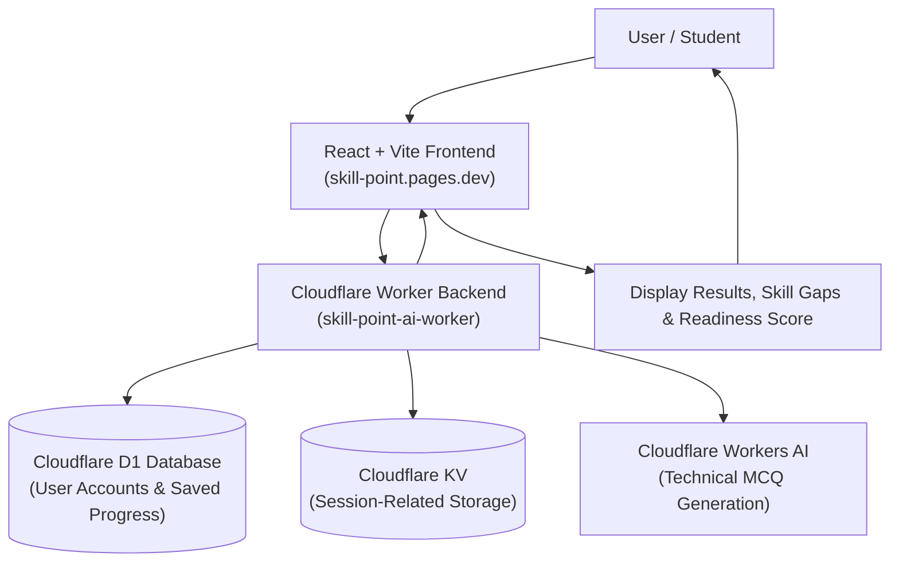

# Skill Point — Job Readiness and Personalized Development System

**Live Website:** [https://skill-point.pages.dev](https://skill-point.pages.dev)

Skill Point is a web-based career readiness and development platform built for computer science students. It helps learners evaluate their technical skills against real job requirements, identify skill gaps, practice technical assessments, track practical learning, and calculate an overall job-readiness score.

---

## Problem Statement

Many computer science students face challenges when preparing for campus placements and software engineering roles:

- Students often do not know whether their current technical skills match the requirements of their target job role.
- It is difficult to identify which specific skills need improvement without structured guidance.
- Resume preparation, technical practice, assignments, and learning milestones are usually tracked separately across different tools.
- Students need a single, easy-to-use platform to check their current preparation level and track progress over time.

Skill Point addresses these problems by providing a unified workflow. Students can select a target career role, analyze their resume against job requirements, identify skill gaps, practice AI-generated technical questions, record completed assignments, and view their estimated job readiness.

---

## Intended Users

- **B.Tech / B.E. CSE and IT Students** preparing for campus placements and internships.
- **Fresh Graduates** preparing for entry-level software engineering positions.
- **Self-Directed Learners** who want to identify and bridge technical skill gaps for specific industry roles.

---

## Key Features

- **User Accounts:** Register and log in to securely access your personal profile and saved data.
- **Target Job Role:** Select the career role you want to prepare for from curated industry profiles or create a custom role.
- **Resume Analysis:** Upload a resume in PDF or DOCX format to identify technical skills mentioned in it.
- **Job Description Analysis:** Examine job requirements and understand the key technical skills expected by employers.
- **Skill Gap Analysis:** Compare your demonstrated skills with the selected job role's requirements in a competency matrix.
- **AI-Based Assessment:** Generate technical multiple-choice questions using Cloudflare Workers AI when available.
- **Assessment Results:** View your test score immediately and review question explanations.
- **Assignments and Learning:** Track completed practical tasks and structured learning activities by topic.
- **Job Readiness:** View an overall readiness score calculated from resume match, assessment results, assignments, and profile completeness.
- **Progress Tracking:** Review saved preparation history and track improvements across sessions.

---

## Architecture and Application Flow

The application follows a serverless architecture using React for the user interface, Cloudflare Workers for the backend API, and Cloudflare cloud services for data storage and AI generation.



1. The student interacts with the **React + Vite Frontend** hosted on Cloudflare Pages.
2. The frontend sends requests with authentication tokens to the **Cloudflare Worker Backend**.
3. The Worker backend handles account records and data persistence via **Cloudflare D1**.
4. Active user sessions are validated with **Cloudflare KV**.
5. Diagnostic technical questions are generated on demand using **Cloudflare Workers AI** (`@cf/meta/llama-3.1-8b-instruct-fp8`).
6. Results, skill gaps, and updated readiness metrics are sent back to the frontend and displayed to the student.

---

## Job-Readiness Formula

The Job-Readiness Score combines four key areas of preparation into a single score out of 100:

$$\text{Job Readiness Score} = (\text{Resume Match} \times 0.40) + (\text{Assessment Score} \times 0.30) + (\text{Assignment Completion} \times 0.20) + (\text{Profile Completeness} \times 0.10)$$

| Component | Weight | Description |
| :--- | :---: | :--- |
| **Resume Skill Match** | **40%** | Percentage of target job skills matched from the student's uploaded resume. |
| **Technical Assessment** | **30%** | Average score achieved across completed diagnostic technical quizzes. |
| **Practical Assignments** | **20%** | Percentage of practical programming assignments marked as completed. |
| **Profile Completeness** | **10%** | Percentage of essential profile and academic details provided by the student. |

Each component is scored from 0 to 100, weighted accordingly, and combined into a final score from 0 to 100%.

> **Note:** The readiness score is an estimate of preparation designed to guide learning, not a guarantee of employment.

---

## Technology Stack

- **Frontend:** React 19, React Router v7, Vite 8, Oxlint
- **Document Parsing:** `pdfjs-dist` (PDF text extraction), `mammoth` (DOCX parsing)
- **Backend API:** Cloudflare Workers (Serverless JavaScript runtime)
- **Database:** Cloudflare D1 (Serverless relational SQLite)
- **Session Cache:** Cloudflare KV
- **AI Inference:** Cloudflare Workers AI (`@cf/meta/llama-3.1-8b-instruct-fp8`)
- **Hosting:** Cloudflare Pages (Frontend SPA), Cloudflare Workers (Backend API)

---

## Local Development Setup

> **Note:** If the live website is temporarily unavailable or a feature is not working, you can run Skill Point on your own computer by following the setup instructions below. Local setup requires Node.js and the appropriate Cloudflare development configuration. Local development may require Cloudflare authentication and network access for the Worker and AI features.

### Prerequisites
- Node.js (version 18 or higher; version 20+ recommended)
- npm (Node Package Manager)
- Windows PowerShell or terminal

### Step 1: Clone the Repository
```powershell
git clone https://github.com/RamVinayak6046/skill-point.git
cd skill-point
```

### Step 2: Install Dependencies
```powershell
# Install frontend dependencies
npm install

# Install backend worker dependencies
cd worker
npm install
cd ..
```

### Step 3: Environment Configuration
Create a `.env` file in the project root:
```env
# Point to your local worker during development or the deployed Cloudflare Worker
VITE_API_BASE_URL=http://localhost:8787
VITE_WORKERS_AI_ENDPOINT=http://localhost:8787
```

### Step 4: Run Development Servers
To run both the frontend and backend worker concurrently:
```powershell
node start-dev.js
```

Or run them in separate terminals:
```powershell
# Terminal 1: Frontend (http://localhost:5173)
npm run dev

# Terminal 2: Worker Backend (http://localhost:8787)
cd worker
npx wrangler dev --port 8787
```

---

## Database Setup and Cloudflare Deployment

### 1. Database Schema Migration (Cloudflare D1)
Execute the database schema on your remote Cloudflare D1 database:
```powershell
cd worker
npx wrangler d1 execute skill_point_db --remote --file=schema.sql
```

### 2. Deploy Backend Worker
```powershell
cd worker
npx wrangler deploy
```

### 3. Deploy Frontend (Cloudflare Pages)
```powershell
# From project root
npm run build
npx wrangler pages deploy dist --project-name skill-point --branch main
```

---

## Author & Academic Information

- **Developer:** Ram Vinayak Ch
- **Student ID:** `vtu29562`
- **Institution:** Vel Tech Rangarajan Dr. Sagunthala R&D Institute of Science and Technology
- **Department:** Department of Computer Science and Engineering
- **Academic Project:** B.Tech CSE Minor Project
- **GitHub:** [@RamVinayak6046](https://github.com/RamVinayak6046)
- **Contact:** `vtu29562@veltech.edu.in`
