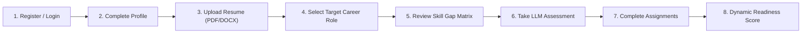

# Skill Point — Job Readiness and Personalized Development System

[](https://skill-point.pages.dev)
[](https://skill-point-ai-worker.ramvinayakch.workers.dev/api/health)
[](https://github.com)

**Skill Point** is a functionality-first, full-stack career readiness web platform built for Computer Science & Engineering undergraduate students. It bridges the gap between academic curricula and industry hiring standards by analyzing target job requirements, extracting resume competencies, generating adaptive LLM technical assessments via Cloudflare Workers AI, tracking practical programming assignments, and dynamically calculating a weighted, mathematically grounded Job-Readiness Score.

---

## 🌐 Live Deployment URLs

- **Frontend Application (Cloudflare Pages)**: [https://skill-point.pages.dev](https://skill-point.pages.dev)
- **Backend API (Cloudflare Worker)**: [https://skill-point-ai-worker.ramvinayakch.workers.dev](https://skill-point-ai-worker.ramvinayakch.workers.dev)
- **Backend Health Check**: [https://skill-point-ai-worker.ramvinayakch.workers.dev/api/health](https://skill-point-ai-worker.ramvinayakch.workers.dev/api/health)

---

## 📌 Problem Statement & Overview

Engineering students frequently struggle to transition from academic coursework to industry-level software roles because:
1. **Curriculum Disconnect**: Traditional university coursework covers foundational theory but rarely maps directly to specific industry role requirements (e.g., Cloud Platforms, Modern Full-Stack, CI/CD, Containerization).
2. **Subjective Self-Assessment**: Students lack an objective, real-time mechanism to measure their actual skill readiness against job descriptions.
3. **Generic Question Banks**: Most evaluation portals offer static, one-size-fits-all question sets rather than contextual, adaptive diagnostics tailored to specific technical competencies.
4. **Scattered Preparation Data**: Academic records, resume revisions, coding exercises, and practice quiz scores are fragmented across multiple disconnected platforms.

**Skill Point** solves this by unifying student profiles, resume extraction, role benchmark requirements, LLM diagnostic testing, assignment tracking, and cloud data persistence into a single cohesive platform.

---

## 🎯 Objectives & Intended Users

### Primary Objectives
- **Target Role Benchmarking**: Allow students to select or define specific career roles with granular proficiency benchmarks.
- **Client-Side Resume Intelligence**: Extract hard and soft skills directly from `.pdf` and `.docx` resumes using browser-based document parsing.
- **Competency Gap Analysis**: Provide a clear visual Competency Matrix contrasting target proficiencies against current demonstrated skills.
- **Adaptive LLM Assessments**: Deliver contextual diagnostic multiple-choice technical assessments generated on-demand by Cloudflare Workers AI.
- **Unified Readiness Metric**: Synthesize resume match, diagnostic assessments, practical assignments, and profile completeness into a transparent 0–100% score.
- **Cross-Device Account Isolation**: Store user profiles and progress in serverless Cloudflare D1 with strict account-level data isolation.

### Intended Users
- **B.Tech / B.E. Computer Science & Engineering Students** preparing for campus placements and off-campus recruitment drives.
- **Job Seekers & Fresh Graduates** targeting entry-level and mid-level software engineering roles.
- **Academic Mentors & Placement Coordinators** seeking verifiable readiness metrics for cohorts.

---

## ✨ Key Features

- **Account Authentication & Cloud Isolation**: User registration and login backed by Cloudflare D1 and KV. Every account accesses strictly isolated records—new accounts always begin with empty states and zero fabricated metrics.
- **Target Career Role Selection**: Browse curated roles (Cloud Solutions Architect, Full-Stack Engineer, Frontend Specialist, Backend Developer, AI/ML Engineer) or define custom roles with customizable skill requirements.
- **Resume & Job Description Analysis**: Browser-side parsing of PDF (`pdfjs-dist`) and Word documents (`mammoth`) to extract relevant technical competencies without sending documents to third-party tracking services.
- **Skill-Gap Analysis & Competency Matrix**: Comparative proficiency visualization highlighting areas requiring immediate study and practical reinforcement.
- **LLM-Powered Adaptive Assessments**: Generates diagnostic assessments dynamically using Meta Llama 3.1 8B Instruct hosted on Cloudflare Workers AI (`@cf/meta/llama-3.1-8b-instruct-fp8`).
- **Tamper-Evident Assessment Scoring**: Server-side session verification via Cloudflare KV ensures submitted answers match server-generated assessment tokens.
- **Practical Assignments & Learning Milestones**: Tracks hands-on programming tasks and learning modules organized by target competency.
- **Deterministic Job-Readiness Score**: A transparent, weighted calculation computed dynamically from verifiable user data.

---

## 🏗️ Architecture

```mermaid
flowchart TD
    subgraph Client["Client Tier (Browser)"]
        SPA["React 19 + Vite SPA (React Router v7)"]
        DOC["Document Parser (pdfjs-dist & mammoth)"]
        AUTH_CTX["AuthContext & AppContext (State Management)"]
        SPA --- DOC
        SPA --- AUTH_CTX
    end

    subgraph Hosting["Cloudflare Global Edge"]
        PAGES["Cloudflare Pages (Static SPA Hosting)"]
        REDIRECTS["_redirects (SPA Client Routing 200 Rewrite)"]
        PAGES --- REDIRECTS
    end

    subgraph Backend["Serverless API Tier"]
        WORKER["Cloudflare Worker (skill-point-ai-worker)"]
        ROUTER["API Router (/api/auth, /api/user/data, /api/generate-mcqs)"]
        QUOTA["Atomic Quota & Rate Limiter"]
        WORKER --- ROUTER
        ROUTER --- QUOTA
    end

    subgraph Persistence["Storage & AI Services"]
        D1[("Cloudflare D1: skill_point_db (SQLite)")]
        KV[("Cloudflare KV: SESSIONS_KV (Auth & Sessions)")]
        AI["Workers AI: @cf/meta/llama-3.1-8b-instruct-fp8"]
    end

    Client -->|HTTPS / Static Assets| PAGES
    Client -->|REST API Requests (Bearer Token)| WORKER
    ROUTER -->|User Auth & Records| D1
    ROUTER -->|Session Validation| KV
    ROUTER -->|MCQ Generation| AI
```

---

## 🔄 Application Workflow



1. **Account Registration**: User registers; credentials and initial profile are stored in Cloudflare D1.
2. **Profile Completion**: User provides academic details (Degree, Branch, Semester, CGPA, College).
3. **Resume Ingestion**: Client-side document parser extracts technical keywords from the uploaded resume.
4. **Target Role Selection**: User selects an industry role or creates a custom role specification.
5. **Skill Gap Computation**: The platform computes the overlap between extracted resume skills and role requirements.
6. **Diagnostic Evaluation**: Cloudflare Workers AI generates a tailored technical quiz. Scores are persisted in D1.
7. **Assignment Tracking**: Practical tasks and roadmap milestones are marked as completed.
8. **Readiness Recalculation**: The overall Job-Readiness Score updates in real-time.

---

## 📊 Job-Readiness Formula

The Job-Readiness Score is calculated using a transparent, multi-component weighted formula:

$$\text{Readiness Score} = (\text{Resume Match} \times 0.40) + (\text{Assessment Score} \times 0.30) + (\text{Practical Assignments} \times 0.20) + (\text{Profile Completeness} \times 0.10)$$

| Component | Weight | Measurement Basis | Formula Details |
| :--- | :---: | :--- | :--- |
| **Resume Skill Match** | **40%** | Overlap between resume skills and target role requirements. | $\frac{|\text{Resume Skills} \cap \text{Role Skills}|}{|\text{Role Skills}|} \times 100$ |
| **Technical Assessment** | **30%** | Average score achieved across completed diagnostic quizzes. | $\frac{\sum \text{Assessment Scores}}{\text{Total Assessments Taken}}$ (0 if none taken) |
| **Practical Assignments** | **20%** | Proportion of hands-on tasks and modules marked completed. | $\frac{\text{Completed Assignments}}{\text{Total Assigned Tasks}} \times 100$ |
| **Profile Completeness** | **10%** | Presence of essential academic and professional profile fields. | Proportion of 10 core fields filled (0–100%) |

> [!NOTE]
> If a student has not yet taken an assessment or selected a target role, those individual factors contribute `0%`—metrics are never fabricated or padded with demo values.

---

## 💻 Technology Stack

### Frontend Application
- **Library**: [React 19](https://react.dev/) (`react`, `react-dom`)
- **Routing**: [React Router v7](https://reactrouter.com/) (`react-router-dom`)
- **Build Tool**: [Vite 8](https://vitejs.dev/) with Fast Refresh
- **Linter**: [Oxlint](https://oxc.rs/)
- **Document Processing**:
  - [`pdfjs-dist`](https://mozilla.github.io/pdf.js/) (v6.4.299) for client-side PDF text extraction
  - [`mammoth`](https://github.com/mwilliamson/mammoth.js) (v1.13.0) for client-side `.docx` parsing

### Serverless Backend
- **Compute**: [Cloudflare Workers](https://workers.cloudflare.com/) (ES Modules runtime)
- **Database**: [Cloudflare D1](https://developers.cloudflare.com/d1/) (Serverless distributed SQLite)
  - Tables: `users`, `user_sessions`, `user_records`, `daily_quota`, `assessment_attempts`
- **Cache & Session Store**: [Cloudflare KV](https://developers.cloudflare.com/kv/) (`SESSIONS_KV`)
- **Large Language Model**: [Cloudflare Workers AI](https://developers.cloudflare.com/workers-ai/)
  - Primary Model: `@cf/meta/llama-3.1-8b-instruct-fp8`
- **Frontend Hosting**: [Cloudflare Pages](https://pages.cloudflare.com/)

---

## 🖼️ Application Screenshots

| Screen | Description | Preview |
| :--- | :--- | :---: |
| **Dashboard** | Overview of readiness metrics, target role, and recent activity. | *[Screenshot: Dashboard View]* |
| **Role Explorer** | Browse roles, custom role creator, and competency requirements. | *[Screenshot: Role Explorer]* |
| **Resume Analysis** | Upload interface, extracted skills, and keyword alignment. | *[Screenshot: Resume Parser]* |
| **AI Assessment** | Real-time diagnostic quiz generated by Workers AI with timer. | *[Screenshot: Assessment Quiz]* |
| **Competency Matrix** | Detailed comparison of required vs. demonstrated proficiencies. | *[Screenshot: Competency Matrix]* |

---

## ⚙️ Local Development Setup

### Prerequisites
- [Node.js](https://nodejs.org/) (v18.0.0 or higher; v20+ recommended)
- `npm` (v9 or higher)
- Cloudflare Wrangler CLI (bundled via `npx wrangler`)
- Windows PowerShell or command prompt

### Step 1: Clone the Repository
```powershell
git clone https://github.com/RamVinayak6046/skill-point.git
cd skill-point
```

### Step 2: Install Dependencies
Install dependencies for both frontend and worker:
```powershell
# Install frontend dependencies
npm install

# Install worker dependencies
cd worker
npm install
cd ..
```

### Step 3: Configure Environment Variables
Create a `.env` file in the project root:
```env
# Point to your local worker during development or the deployed Cloudflare Worker
VITE_API_BASE_URL=http://localhost:8787
VITE_WORKERS_AI_ENDPOINT=http://localhost:8787
```

For the backend Worker, review `worker/wrangler.toml`:
```toml
name = "skill-point-ai-worker"
main = "src/index.js"
compatibility_date = "2024-09-23"

[ai]
binding = "AI"

[[kv_namespaces]]
binding = "SESSIONS_KV"
id = "<your-kv-namespace-id>"

[[d1_databases]]
binding = "DB"
database_name = "skill_point_db"
database_id = "<your-d1-database-id>"

[vars]
ENVIRONMENT = "development"
MAX_DAILY_REQUESTS = "100"
```

### Step 4: Run Development Servers
You can run both servers simultaneously using the included runner:
```powershell
# Runs frontend on http://localhost:5173 and worker on http://localhost:8787
node start-dev.js
```

Or run them in separate terminals:
```powershell
# Terminal 1: Frontend
npm run dev

# Terminal 2: Worker Backend
cd worker
npx wrangler dev --port 8787
```

---

## 🗄️ Database Setup & Cloudflare Deployment

### 1. Database Migration (Cloudflare D1)
Execute the non-destructive schema on your remote Cloudflare D1 database:
```powershell
cd worker
npx wrangler d1 execute skill_point_db --remote --file=schema.sql
```

### 2. Deploy Backend Worker
```powershell
cd worker
npx wrangler deploy
```

### 3. Deploy Frontend (Cloudflare Pages)
```powershell
# From project root
npm run build
npx wrangler pages deploy dist --project-name skill-point --branch main
```

---

## 🧪 Testing and Verification Suite

The repository includes automated test and verification scripts:

| Command | Purpose |
| :--- | :--- |
| `npm run lint` | Runs Oxlint across all JavaScript and JSX source files. |
| `npm run build` | Compiles the production Vite bundle with size auditing. |
| `node e2e-validation.js` | Validates end-to-end data flow between components. |
| `node test-account-switching-isolation.js` | Verifies strict zero-data account switching isolation. |
| `node test-cloud-auth-persistence.js` | Tests user registration, session tokens, and D1 persistence. |
| `node test-llm-mcqs.js` | Tests Workers AI MCQ generation and fallback mechanics. |
| `node test-readiness.js` | Validates mathematical precision of the readiness calculation. |

---

## ⚠️ Known Limitations & Future Enhancements

### Known Limitations
- **Serverless AI Cold Starts**: First-time generation requests via `@cf/meta/llama-3.1-8b-instruct-fp8` on Cloudflare Workers AI may take 5–10 seconds.
- **Client-Side Document Parsing**: Heavily stylized, multi-column graphical resumes or scanned image PDFs cannot be OCR-parsed; text-based PDFs and DOCX files are required.
- **Daily Request Quota**: A free-tier safeguard (`MAX_DAILY_REQUESTS = 100`) is enforced at the database level to protect against bot abuse.

### Future Enhancements
- **In-Browser Coding Playground**: WebAssembly-powered execution sandbox for live coding assessments.
- **GitHub Repository Analysis**: Direct evaluation of public repositories to automatically verify practical project contributions.
- **Peer Benchmarking**: Anonymized percentile rankings across college cohorts for placement coordinators.

---

## 👨‍💻 Author & Academic Attribution

- **Developer**: Ram Vinayak Ch
- **Student ID**: `vtu29562`
- **Institution**: Vel Tech Rangarajan Dr. Sagunthala R&D Institute of Science and Technology
- **Department**: Department of Computer Science and Engineering
- **Academic Project**: B.Tech CSE Minor Project
- **GitHub**: [@RamVinayak6046](https://github.com/RamVinayak6046)
- **Contact**: `vtu29562@veltech.edu.in`
